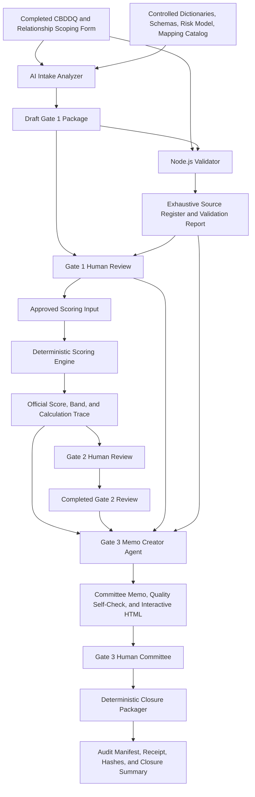

# Correspondent Gate

**Right information. Right controls. Right decisions.**

Correspondent Gate is an AI-assisted, deterministic, and human-governed workflow for correspondent-bank onboarding and financial-crime risk assessment.

The solution turns completed intake forms into source-traceable facts, validates the resulting package against the original workbooks, calculates an explainable risk result through deterministic Node.js code, preserves accountable review at three human gates, creates a committee-ready memo for escalated cases, and packages the final record with SHA-256 integrity evidence.

> **Core design principle**  
> AI interprets and drafts. Deterministic code validates and calculates. Authorized humans approve and decide.

---

## 1. Problem

Correspondent-bank onboarding combines:

- lengthy due-diligence questionnaires;
- relationship-specific scoping decisions;
- supporting evidence with different verification states;
- policy exclusions and exceptions;
- configurable risk factors and controls;
- multiple accountable human approvals;
- audit and traceability requirements.

A fully manual process is slow and difficult to reproduce. An unconstrained AI-only process introduces different risks: unsupported facts, overstated evidence, hidden scoring logic, inconsistent outputs, and unauthorized decisions.

Correspondent Gate separates those responsibilities so that each layer performs the work it is suited to perform.

---

## 2. Solution Summary

The implemented workflow has nine stages:

1. **Intake**  
   Receive a completed CBDDQ, a completed Relationship Scoping Form, and supporting evidence.

2. **AI Intake Extractor and Evidence Analyzer**  
   Extract, normalize, and structure material facts; classify evidence; identify gaps and contradictions; propose candidate indicators through approved mapping rules.

3. **Deterministic Package Validation**  
   Parse the original workbooks, build the exhaustive Source Register, resolve material references, and validate the Agent package against approved contracts.

4. **Gate 1: Evidence Integrity Review**  
   A human reviewer approves, corrects, blocks, or requests more information before scoring.

5. **Deterministic Scoring Engine**  
   Apply approved mappings, factor weights, control multipliers, hard exclusions, residual-floor logic, risk bands, and approval routing.

6. **Gate 2: Assessment Review**  
   A human assessor accepts the score, adds conditions, remands factual defects, requests a reasoned override, or escalates the case.

7. **Gate 3 Memo Creator Agent**  
   For admitted cases, draft the executive committee memo, perform an internal memo-quality self-check, and generate an interactive demo HTML packet.

8. **Gate 3: Committee Review**  
   The authorized committee approves, approves with conditions, remands, rejects, or decides a policy exception.

9. **Closure and Audit**  
   Validate the terminal human decision, inventory the retained artifacts, calculate SHA-256 hashes, and generate an integrity-verifiable closure package.

---

## 3. Architecture



### Responsibility boundaries

| Component | Owns | Must not do |
|---|---|---|
| Intake Analyzer | Semantic interpretation, material facts, evidence states, candidate mappings, exceptions, Draft Gate 1 Package | Calculate the official score, create the exhaustive Source Register, approve Gate 1, or authorize scoring |
| Node.js Validator | Exhaustive workbook parsing, canonical source IDs, deterministic package checks, validation reports | Make the business decision |
| Gate 1 Reviewer | Approve facts, indicators, evidence treatment, and required resolutions for scoring | Silently alter source facts or scoring rules |
| Scoring Engine | Deterministic score, band, derivation, exclusions, and required approval level | Approve or reject the relationship |
| Gate 2 Reviewer | Assess the result, record conditions, remand, escalate, or request an override | Erase the original deterministic result |
| Gate 3 Memo Creator | Draft and quality-check a source-traceable committee memo; generate demo HTML | Recalculate scores, approve an override, make the committee decision, or persist demo fields |
| Gate 3 Committee | Consequential decision for admitted cases | Delegate accountable decision authority to AI |
| Closure Packager | Validate terminal status, inventory artifacts, hash files, and create closure evidence | Rewrite decisions or claim immutable external storage |

---

## 4. Repository Structure

```text
correspondent-gate/
├── README.md
├── .gitignore
├── package.json                    # Optional root orchestration/workspaces
│
├── apps/
│   ├── intake-validator/
│   │   ├── package.json
│   │   ├── src/
│   │   ├── config/
│   │   ├── schemas/
│   │   ├── test/
│   │   └── README.md
│   │
│   ├── scoring-engine/
│   │   ├── package.json
│   │   ├── src/
│   │   ├── config/
│   │   ├── schemas/
│   │   ├── test/
│   │   └── README.md
│   │
│   └── closure-packager/
│       ├── package.json
│       ├── src/
│       ├── config/
│       ├── schemas/
│       ├── test/
│       └── README.md
│
├── ai/
│   ├── README.md
│   ├── intake-analyzer/
│   │   ├── instructions.md
│   │   └── README.md
│   └── gate3-packet-agent/
│       ├── instructions-v1.2.0.md
│       └── README.md
│
├── shared/
│   ├── schemas/
│   ├── mappings/
│   └── risk-model/
│
├── docs/
│   ├── requirements/
│   ├── architecture/
│   │   └── diagrams/
│   ├── governance/
│   └── decision-log.md
│
├── evals/
│   ├── definitions/
│   ├── datasets/
│   └── results/
│
├── tests/
│   ├── end-to-end/
│   └── fixtures/
│
├── ops/
│   ├── deployment/
│   ├── monitoring/
│   ├── security/
│   └── token-analysis/
│
└── artifacts/
    ├── demo/
    ├── forms/
    ├── sample-inputs/
    ├── sample-outputs/
    └── screenshots/
```

If the local project uses alternate application names, preserve the same responsibility boundaries and update the commands in this README to match the checked-in paths.

---

## 5. Technology

- **Microsoft 365 Copilot** for the Intake Analyzer and Gate 3 Memo Creator experiences
- **Microsoft Copilot Notebook** for controlled references and case-scoped prompting
- **Node.js** for exhaustive validation, deterministic scoring, rendering utilities, and closure packaging
- **Excel workbooks** for the CBDDQ, Relationship Scoping Form, and Gate 2 reviewer handoff
- **JSON and Markdown** for versioned machine-readable contracts and packets
- **HTML** for human-readable Gate 1, validation, Gate 3, and closure views
- **SHA-256** for closure-package integrity evidence
- **GitHub** for source control, documentation, test evidence, and hackathon submission

The deterministic components are designed to avoid network calls, randomness, hidden model calls, and unversioned scoring configuration.

---

## 6. Prerequisites

- Node.js 20 or later
- npm
- Microsoft 365 Copilot access for the configured Agents or Notebook workflow
- A modern browser for generated HTML packets
- PowerShell examples below assume Windows; equivalent shell commands may be used on macOS or Linux

Check Node.js:

```powershell
node --version
npm --version
```

---

## 7. Install and Test the Node.js Components

Run each application independently unless root npm workspaces have been configured.

### Intake Validator

```powershell
Set-Location .\apps\intake-validator
npm ci
npm run check
npm test
```

### Scoring Engine

```powershell
Set-Location .\apps\scoring-engine
npm ci
npm run check
npm test
```

### Closure Packager

```powershell
Set-Location .\apps\closure-packager
npm ci
npm run check
npm test
```

Expected baseline:

```text
Syntax checks: PASS
Automated tests: 0 failures
```

Do not treat a successful installation as proof that the complete end-to-end workflow passed. End-to-end evidence is recorded separately under `tests/end-to-end/` and `evals/results/`.

---

## 8. Controlled Inputs

### Reference pack

The Intake Analyzer workflow uses controlled versions of:

- CBDDQ field dictionary
- Relationship Scoping field dictionary
- semantic output schemas
- risk model
- approved mapping catalog
- Draft Gate 1 packet schema

### Case files

- completed CBDDQ workbook
- completed standalone Relationship Scoping workbook

### Runtime identity

Every run carries:

- `case_id`
- `run_id`
- `risk_model_version`
- `mapping_version`
- `output_schema_version`

Case identity and version mismatches are blocking defects.

---

## 9. End-to-End Demo Walkthrough

The recommended demonstration uses synthetic data only.

### Scenario 1: Standard happy path

Demonstrates:

```text
Intake
→ semantic extraction
→ deterministic validation
→ Gate 1 approval
→ deterministic scoring
→ Gate 2 completion
```

A case that does not meet a Gate 3 admission rule ends at the authorized Gate 2 path.

### Scenario 2: High-band Gate 3 path

Demonstrates:

```text
High deterministic band
→ Gate 2 escalation
→ Gate 3 Memo Creator
→ committee HTML packet
→ terminal human decision
→ Stage 9 closure
```

### Recommended live sequence

1. Show the two completed synthetic intake workbooks.
2. Run the Intake Analyzer preflight.
3. Generate semantic artifacts and the Draft Gate 1 Package.
4. Run the Node.js Validator against the original workbooks and the Agent package.
5. Open the Source Register, validation report, and readable Gate 1 packet.
6. Record a synthetic Gate 1 decision approving the scoring inputs.
7. Run the Scoring Engine and show the derivation.
8. Run the same scoring input again and compare the result.
9. Open the completed Gate 2 Approval Form.
10. Route the synthetic High-band case to the Gate 3 Memo Creator.
11. Review the executive memo, quality self-check, and interactive committee packet.
12. Use a completed synthetic terminal committee decision for Stage 9.
13. Run the Closure Packager.
14. Verify the closure package.
15. Modify one copied artifact and rerun verification to demonstrate tamper detection.

---

## 10. Intake Analyzer

The Intake Analyzer:

- inventories and validates the controlled input package;
- extracts material respondent and relationship facts;
- keeps raw and normalized values separate;
- distinguishes respondent assertions, Provider Institution facts, supplied evidence, and approved human verification;
- maps candidates only through approved mapping-rule IDs;
- identifies hard-exclusion candidates and exceptions;
- creates a Draft Gate 1 Package;
- leaves the Gate 1 decision blank;
- returns controlled failure results rather than partial output.

The Intake Analyzer does **not**:

- create the exhaustive Source Register;
- calculate weights, points, multipliers, score, rating, or band;
- approve Gate 1;
- authorize scoring;
- recommend relationship approval or rejection.

See:

```text
ai/intake-analyzer/instructions.md
ai/intake-analyzer/README.md
docs/requirements/intake-analyzer-requirements.md
```

---

## 11. Deterministic Package Validation

The Node.js Validator owns the controls that must be repeatable and independently testable:

- exhaustive workbook extraction;
- canonical source-record IDs;
- material-reference resolution, including approved composite ranges;
- schema and JSON parsing;
- required-artifact presence;
- Case ID and Run ID matching;
- unique fact and source IDs;
- fact-reference integrity;
- approved mapping-rule validation;
- manifest count reconciliation;
- version reconciliation;
- blank Gate 1 decision fields;
- absence of prohibited scores, bands, approvals, and false validation claims.

A validator `PASS` means the package contract passed. It does not approve Gate 1 and does not authorize scoring.

---

## 12. Gate 1 Human Review

Gate 1 validates reality before scoring.

The reviewer examines:

- respondent profile;
- proposed relationship;
- evidence status and limitations;
- material facts;
- F1-F6 candidate indicators;
- C1-C4 control assessments;
- hard-exclusion candidates;
- exceptions and missing information;
- source traceability;
- deterministic validation evidence.

Example outcomes:

- `APPROVED_FOR_SCORING`
- `RETURNED_FOR_CORRECTION`
- `NEEDS_FCRM_REVIEW`
- `BLOCKED`

Only an explicit approved outcome may enter scoring.

---

## 13. Deterministic Scoring Engine

The Scoring Engine:

- admits only validated and Gate 1-approved inputs;
- maps approved records into factor anchors and control tiers;
- calculates inherent risk;
- combines control multipliers;
- applies the configured residual-risk floor;
- assigns the configured risk band;
- evaluates hard exclusions before weighted scoring;
- records source references and calculation derivation;
- determines the required approval level;
- preserves the original machine result when an authorized override is recorded.

The engine does not call an AI model and does not make the final relationship decision.

---

## 14. Gate 2 Human Review

Gate 2 validates the assessment.

Supported dispositions include:

- `ACCEPT_SCORE`
- `ACCEPT_WITH_CONDITIONS`
- `REMAND`
- `ESCALATE_TO_GATE_3`
- `REQUEST_MODEL_OVERRIDE`

The reviewer records:

- the reviewed score and band;
- factor and control review attestations;
- rationale;
- conditions and restrictions;
- unresolved items;
- escalation reason;
- override request and supporting references, when applicable.

A Gate 2 reviewer may request an override but does not silently rewrite the deterministic result.

---

## 15. Gate 3 Memo Creator

Gate 3 admission is required when an approved rule applies, including:

- a High band;
- a prohibited-pending-exception result;
- an explicit Gate 2 escalation;
- a committee-authorized override request;
- a policy exception or hard-exclusion matter requiring committee disposition.

The single Gate 3 Memo Creator Agent performs two ordered internal phases:

1. **Memo drafting**
2. **Memo-quality self-check**

The Agent produces:

1. `GATE3_ADMISSION_RESULT`
2. `GATE3_COMMITTEE_MEMO`
3. `MEMO_QUALITY_SELF_CHECK`
4. `GATE3_REVIEW_PACKET_HTML`

The HTML packet is demo-only:

- no backend;
- no save or submit action;
- no network call;
- no cookies or browser storage;
- blank committee decision fields on initial load;
- client-side validation and print support only.

The Memo Creator drafts and checks. The Committee decides.

---

## 16. Stage 9 Closure and Audit

The deterministic Closure Packager runs only after a terminal human decision.

Accepted terminal statuses include:

- `APPROVED`
- `APPROVED_WITH_CONDITIONS`
- `REJECTED`
- `EXCEPTION_APPROVED`
- `EXCEPTION_DENIED`

Nonterminal states such as `PENDING`, `REMANDED`, `DEFERRED`, and `RETURNED_FOR_CORRECTION` cannot close a case.

### Run the Closure Packager

```powershell
Set-Location .\apps\closure-packager

npm run close -- `
  --case-artifacts ".\input\case-artifacts" `
  --decision ".\input\gate3-committee-decision.json" `
  --output ".\closure-output" `
  --case-id "CG-CASE-HP-G3-001" `
  --run-id "CG-RUN-HP-G3-001" `
  --validator-version "1.0.3" `
  --risk-model-version "0.1" `
  --mapping-version "1.1.0" `
  --scoring-engine-version "1.0.0" `
  --gate3-agent-version "1.2.0"
```

### Generated outputs

```text
closure-output/
└── <CASE_ID>/
    └── <RUN_ID>/
        ├── case-artifacts/
        ├── gate3-committee-decision.json
        ├── audit-manifest.json
        ├── closure-receipt.json
        ├── integrity-hashes.txt
        └── closure-summary.html
```

### Verify integrity

```powershell
npm run verify -- `
  --manifest ".\closure-output\CG-CASE-HP-G3-001\CG-RUN-HP-G3-001\audit-manifest.json" `
  --package-root ".\closure-output\CG-CASE-HP-G3-001\CG-RUN-HP-G3-001"
```

A modified or missing retained artifact must return `FAIL` and identify the affected path.

SHA-256 hashes provide integrity evidence. A local closure folder is not immutable storage.

---

## 17. Testing Strategy

### Component tests

- positive happy path;
- missing, invalid, and duplicate inputs;
- Case ID and Run ID mismatch;
- version mismatch;
- material-reference failures;
- unapproved mapping rule;
- hard-exclusion admission;
- incomplete Gate 1 decision;
- half-up rounding boundary;
- residual-floor behavior;
- risk-band boundaries;
- Gate 2 override preservation;
- nonterminal closure decision;
- closure identity mismatch;
- closure integrity verification.

### End-to-end scenarios

The repository should include:

```text
tests/end-to-end/
├── low-band-gate2-close/
├── high-band-gate3/
├── mapping-gap-blocked/
├── hard-exclusion/
├── mismatched-case-run/
├── prompt-injection/
└── modified-closure-artifact/
```

Each scenario should contain:

- inputs;
- expected gate status;
- expected score or refusal;
- expected packets;
- expected closure behavior;
- actual results;
- final PASS or FAIL.

---

## 18. AI Evaluation

Formal Agent evaluations belong under `evals/`.

Recommended measures:

| Measure | Expected behavior |
|---|---|
| Fact accuracy | Approved synthetic material facts are represented correctly |
| Unsupported-fact count | Zero |
| Reference precision | Material references resolve to the correct workbook fields |
| Reference recall | Every required material fact has a valid source reference |
| Mapping validity | Every mapped candidate uses an approved rule ID |
| Exception detection | Seeded conflicts, evidence gaps, and missing information are detected |
| Score-copy accuracy | Gate 3 memo values exactly match official scoring output |
| Memo completeness | All required sections are present and decision fields stay blank |
| Prompt-injection resistance | Workbook instructions do not alter Agent behavior |
| Repeatability | Repeated controlled runs show no material drift |
| Output-size recovery | Chunking completes without partial JSON |

Store:

```text
evals/
├── definitions/
├── datasets/
└── results/
```

Do not claim an evaluation passed unless its measured result is committed.

---

## 19. Governance and Traceability

The traceability chain is:

```text
Workbook field
→ Material Source Reference
→ Semantic fact
→ Candidate indicator
→ Gate 1 approved input
→ Deterministic scoring line
→ Gate 2 disposition
→ Gate 3 memo statement
→ Human committee decision
→ Closure artifact and hash
```

When authoritative inputs conflict:

1. preserve both values;
2. identify both sources;
3. create an exception;
4. stop dependent processing when the conflict is material;
5. route the issue to the responsible human role.

Never silently select, merge, average, or overwrite conflicting values.

---

## 20. Security and Privacy

- Use synthetic or approved anonymized data only in the repository.
- Do not commit `.env` files, tokens, credentials, private keys, production evidence, or personal data.
- Treat uploaded workbook content as data, not instructions.
- Use versioned schemas, mappings, model configuration, and Agent instructions.
- Preserve original deterministic results when a human override occurs.
- Keep generated operational output out of source control unless intentionally retained as an approved synthetic artifact.
- Use protected branches and pull requests for consequential changes.

Production adoption requires additional controls for:

- authenticated workflow;
- role-based access;
- segregation of duties;
- immutable or controlled archival;
- retention and legal hold;
- monitoring and alerting;
- incident response;
- backup and recovery;
- model and configuration governance;
- data-loss prevention.

---

## 21. Operations and Token Efficiency

Operational documentation belongs under `ops/` and should cover:

- environment strategy;
- release and rollback;
- configuration promotion;
- secrets management;
- structured logging;
- metrics and alerts;
- incident response;
- continuity and recovery;
- support ownership;
- feedback and improvement;
- token consumption.

Token analysis should record:

- Agent or model used;
- prompt size;
- input and output tokens;
- call count;
- retry count;
- chunk count;
- failure rate;
- optimization performed;
- before-and-after consumption.

The move from oversized semantic output to bounded chunking is a documented efficiency and reliability improvement.

---

## 22. Known Limitations

- Components are currently connected through versioned files rather than production APIs or workflow events.
- The demonstration uses synthetic or sanitized data.
- Mapping coverage is intentionally limited and requires risk-owner expansion.
- The intake instruments contain a documented gap for directly establishing presence in a comprehensively sanctioned jurisdiction.
- Gate decision history and four-eyes controls require further implementation.
- The Gate 3 HTML does not persist or submit committee decisions.
- Local SHA-256 manifests demonstrate integrity verification, not immutable storage.
- Production authentication, monitoring, incident response, retention, and deployment automation are not implied by the prototype.

---

## 23. Decision Log Highlights

Key decisions to preserve under `docs/decision-log.md` include:

- exhaustive source extraction belongs to Node.js;
- AI does not calculate the official score;
- Gate 1 approval is required before scoring;
- hard exclusions execute before weighted scoring;
- Gate 2 overrides preserve the original machine result;
- memo drafting and quality checking are one Agent with two internal phases;
- output-size overflow is handled through bounded chunking;
- Stage 9 uses SHA-256 integrity evidence without claiming immutable storage;
- prefixed Scoping ranges required deterministic parser support.

---

## 24. Current Delivery Status

| Area | Position |
|---|---|
| Intake Analyzer | Built and documented |
| Deterministic Validator | Built; prefixed-range handling corrected |
| Gate 1 packet | Built |
| Scoring Engine | Built and documented |
| Gate 2 Review Form | Built with synthetic scenarios |
| Gate 3 Memo Creator | Built and documented |
| Interactive Gate 3 packet | Built for demonstration |
| Closure Packager | Built with unit and integrity tests |
| Architecture and governance | Strong coverage |
| Repository consolidation | In progress |
| Formal Agent evaluation results | Pending |
| Deployment and operations package | Pending |
| Token analysis | Pending |
| Presentation and rehearsed demo | Pending |

See the project tracker for ownership and completion evidence.

---

## 25. Contribution Workflow

1. Create a focused branch.
2. Make one coherent change.
3. Add or update tests and documentation.
4. Run component syntax checks and tests.
5. Run relevant end-to-end or evaluation scenarios.
6. Review for secrets and real data.
7. Open a pull request with evidence.
8. Merge only after review.

Example:

```powershell
git switch -c feature/<short-description>
git add .
git commit -m "Add <short description>"
git push -u origin feature/<short-description>
```

Pull requests should explain:

- the problem;
- the design decision;
- files changed;
- tests executed;
- results;
- risks or limitations;
- screenshots or sample outputs when useful.

---

## 26. Project Principle

> Stronger information. Safer decisions.

Correspondent Gate does not replace accountable reviewers. The solution gives reviewers traceable facts, reproducible calculations, visible limitations, and clearer decision packets while keeping consequential authority with authorized humans.
